<div align="center">



**Katalog anime berbahasa Indonesia** — temukan anime trending, cek jadwal tayang mingguan, lihat daftar episode, buka di situs nonton resmi, dan lacak progres nontonmu.

<a href="https://superrrkyy.github.io/animeku/"></a>


</div>

---

## ✨ Fitur

**🏠 Beranda**
- 🎞️ Slider hero anime trending (berganti otomatis)
- 🔥 Sedang Trending, 🍁 Populer Musim Ini, 🏆 Rating Tertinggi, 🗓️ Segera Tayang
- ⏳ Hitung mundur episode berikutnya di setiap kartu

**🔍 Jelajah**
- Pencarian otomatis saat mengetik
- Filter **16 genre**
- Tombol "Muat lebih banyak"

**📅 Jadwal Tayang**
- Jadwal 7 hari ke depan
- Jam tayang sesuai **zona waktu perangkatmu** (WIB/WITA/WIT otomatis)
- Penanda "Sudah tayang" / "Akan tayang"

**📖 Halaman Detail**
- Banner, skor, jumlah penonton & favorit
- ▶️ Trailer YouTube langsung di halaman
- **▶️ Tonton di** — tombol ke situs streaming resmi (Crunchyroll, Netflix, Bilibili TV, dll)
- **📺 Daftar Episode** — judul tiap episode + thumbnail; klik untuk membuka episode di situs resminya
- **✅ Pelacak progres** — centang episode yang sudah ditonton, simpan otomatis di perangkat
- Sinopsis, informasi lengkap (studio, musim, durasi, sumber)
- 👥 Karakter utama & ✨ rekomendasi anime serupa

**❤️ Favorit**
- Simpan anime favorit, tersimpan otomatis di perangkat
- ⏳ **Lanjut Nonton** di beranda: lanjut dari episode yang belum kamu tandai

**📱 Lainnya**
- Navigasi bawah ala aplikasi di HP
- Skeleton loading & animasi halus
- Bisa dibagikan: setiap anime punya link sendiri, contoh `#/anime/154587`

## 🛠️ Teknologi

| Bagian | Teknologi |
|:--|:--|
| UI | React 18 + TypeScript |
| Styling | Tailwind CSS 3 |
| Build | Vite 6 |
| Data | [AniList GraphQL API](https://anilist.co) |
| Deploy | GitHub Actions → Pages |

## 📂 Struktur

```
animeku/
├── .github/workflows/deploy.yml
├── assets/banner.svg
├── public/favicon.svg
├── src/
│   ├── components/Card.tsx
│   ├── pages/
│   │   ├── Home.tsx
│   │   ├── Browse.tsx
│   │   ├── Schedule.tsx
│   │   └── Detail.tsx
│   ├── api.ts
│   ├── store.ts
│   ├── App.tsx
│   ├── main.tsx
│   └── index.css
├── index.html
├── package.json
├── vite.config.ts
├── tailwind.config.js
├── postcss.config.js
└── tsconfig.json
```

## 🚀 Jalankan Lokal

```bash
npm install
npm run dev
```

> [!NOTE]
> Sinopsis berasal dari AniList dan berbahasa Inggris. Konten dewasa disaring otomatis.

---

<div align="center">

Dibuat dengan 💜 oleh [**AXRYZURE**](https://github.com/superrrkyy) • 🇮🇩

⭐ Beri bintang jika kamu suka!

</div>
